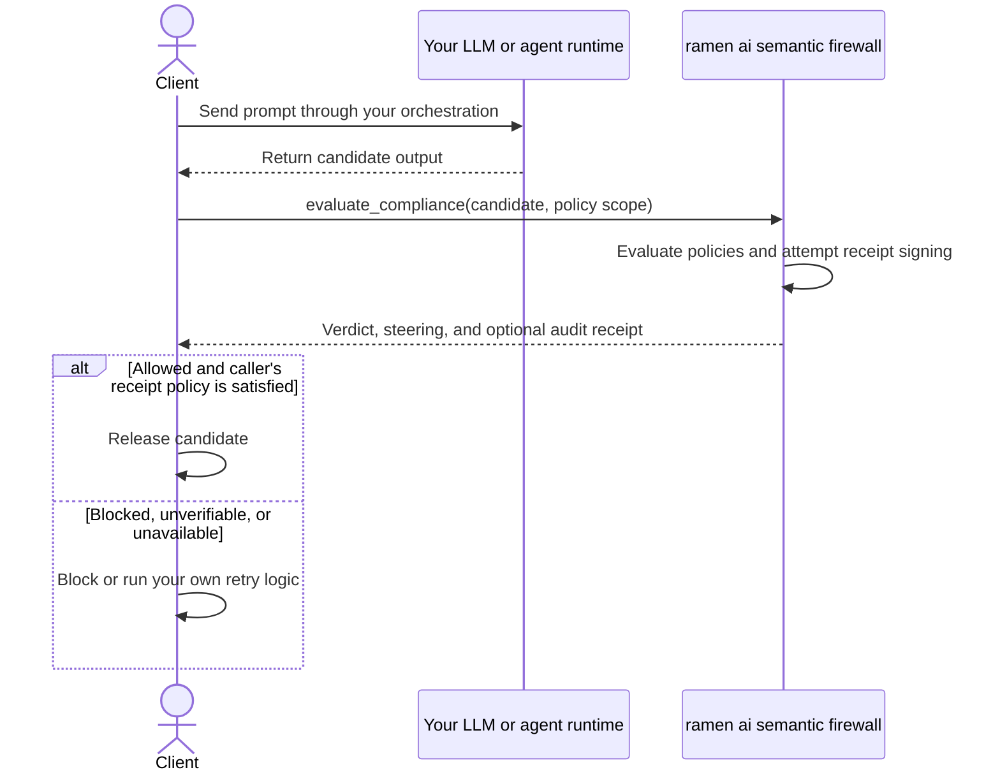
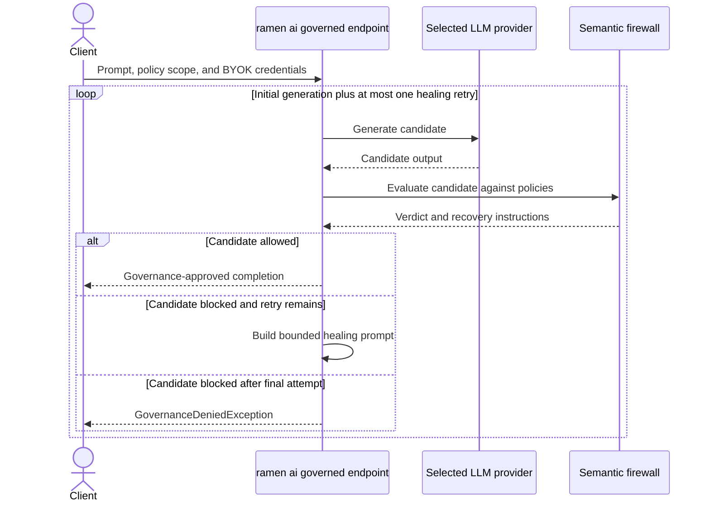

# ramen-ai-core (Python)

<p align="center">
  
</p>


Synchronous Python HTTP client for passive evaluation and governed generation,
with V5 Ed25519 receipt verification for the [ramen-ai](https://ramenai.dev)
PaaS API. The shared SDK used by all Python-based ramen-ai integrations
(LangChain, PydanticAI, and custom tooling).

Requires **Python ≥ 3.10**. Dependencies:
[`httpx`](https://www.python-httpx.org/) and
[`cryptography`](https://cryptography.io/).

---

## API Key

To use this SDK, you must mint an API Key. We offer a **Free Starter Tier**
(1,000 evaluations/month, BYOK) which includes full access to our Core IT
Security bundle. Mint your key at:
**[https://ramenai.dev/pricing](https://ramenai.dev/pricing)**

---

## Installation

```bash
pip install ramen-ai-core
```

Or install from the monorepo:

```bash
pip install -e core-clients/python
```

---

## Usage

The SDK supports two architectural approaches. Choose the passive firewall when
your application already owns generation and agent state. Choose the active
cascade when you want ramen ai to orchestrate generation, policy evaluation,
and one bounded healing retry behind a single method.

### Passive Firewall (Bring Your Own Orchestration)

Use `evaluate_compliance` when your LangChain graph, MCP host, custom agent, or
application already calls the LLM. Your code submits the candidate output to
ramen ai, inspects the verdict and the local verification result when a V5
receipt is present, then decides whether to release, retry, or block it.



```python
import os
from ramen_ai import RamenClient

# Replace this placeholder with output from your own LLM or agent workflow.
candidate = "Candidate output returned by your orchestration"
with RamenClient(api_key=os.environ["RAMEN_API_KEY"]) as client:
    result = client.evaluate_compliance(
        input_text=candidate,
        bundle_ids=["ramen__eu_ai_act_baseline"],
        context={"workflow": "customer-guidance"},
        provider_key=os.environ.get("OPENAI_API_KEY"),
        provider_name="openai",
    )

if not result["allowed"] or not result["receipt_verified"]:
    reason = result["steering"] or result["receipt_reason"] or "Evaluation failed"
    raise RuntimeError(reason)

print(candidate)  # Your application controls release.
```

At least one `bundle_ids` or `policy_ids` entry is required. The passive method
does not call an LLM or retry automatically; orchestration remains entirely in
your application.

### Active Self-Correcting Cascade (Zero-Configuration Orchestration)

Use `generate_governed` or `generate_governed_stream` when you want one SDK
call to invoke the governed endpoint for LLM generation, strict semantic
evaluation, and a bounded healing retry. Under the governed endpoint protocol,
if the first candidate is semantically blocked and `max_retries` is `1`, the
backend may build one constrained healing prompt from policy recovery
instructions and generate one more candidate. The protocol releases an allowed
completion or returns a structured denial; the examples below also recheck
`evaluation.allowed` before using content as a defense-in-depth invariant.



#### Non-streaming governed generation

Python BYOK credentials are per-call parameters. Passing `provider_key`
explicitly funds generation on Starter and Professional tiers; the client
forwards it as `X-Provider-Key` only for that request.

```python
import os
from ramen_ai import (
    GovernanceDeniedException,
    GovernedGenerationException,
    GovernedGenerationOptions,
    RamenClient,
)

with RamenClient(api_key=os.environ["RAMEN_API_KEY"]) as client:
    try:
        result = client.generate_governed(
            "Draft a customer response explaining the available options.",
            bundle_ids=["ramen__eu_ai_act_baseline"],
            max_retries=1,  # one additional generation attempt at most
            generation=GovernedGenerationOptions(
                temperature=0.2,
                max_tokens=1024,
            ),
            provider_key=os.environ["OPENAI_API_KEY"],  # Starter/Professional
            provider_name="openai",                     # use "google" for Gemini
        )

        if not result.evaluation.allowed:
            raise RuntimeError("Unexpected non-allowed governed completion")
        print(result.content)
        print("Attempts:", result.attempts)
        if result.evaluation.receipt_id:
            print("Audit receipt ID:", result.evaluation.receipt_id)
    except GovernanceDeniedException as exc:
        print("No generated candidate passed governance", exc.data.evaluation)
    except GovernedGenerationException as exc:
        print(exc.status, exc.code, str(exc))
```

#### Streaming governed generation

The synchronous iterator yields `status`, `heartbeat`, and one successful
`complete` event. Candidate tokens are not streamed before evaluation.
Terminal `blocked` and `error` SSE messages are raised as exceptions rather
than yielded as events.

```python
with RamenClient(api_key=os.environ["RAMEN_API_KEY"]) as client:
    try:
        for event in client.generate_governed_stream(
            "Draft a customer response explaining the available options.",
            bundle_ids=["ramen__eu_ai_act_baseline"],
            max_retries=1,
            generation=GovernedGenerationOptions(
                temperature=0.2,
                max_tokens=1024,
            ),
            provider_key=os.environ["OPENAI_API_KEY"],  # Starter/Professional
            provider_name="openai",
        ):
            if event.event == "status":
                print(event.data.stage, event.data.attempt)
            elif event.event == "complete":
                if not event.data.data.evaluation.allowed:
                    raise RuntimeError("Unexpected non-allowed governed completion")
                print(event.data.data.content)
    except GovernanceDeniedException as exc:
        print("Blocked after all governed attempts", exc.data)
    except GovernedGenerationException as exc:
        print(exc.code, str(exc))
```

`max_retries` defaults to `1` and accepts only `0` or `1`; it counts additional
generations, so at most two candidates are generated. The clients do not replay
transport failures. Governed completion means the server reported strict policy
approval.

#### Governed-generation method signatures

```python
def generate_governed(
    prompt: str,
    *,
    policy_ids: Sequence[str] | None = None,
    bundle_ids: Sequence[str] | None = None,
    max_retries: Literal[0, 1] = 1,
    generation: GovernedGenerationOptions | None = None,
    provider_key: str | None = None,
    provider_name: GovernedProviderName | None = None,
) -> GovernedCompleteData: ...

def generate_governed_stream(
    prompt: str,
    *,
    policy_ids: Sequence[str] | None = None,
    bundle_ids: Sequence[str] | None = None,
    max_retries: Literal[0, 1] = 1,
    generation: GovernedGenerationOptions | None = None,
    provider_key: str | None = None,
    provider_name: GovernedProviderName | None = None,
) -> Iterator[GovernedStreamEvent]: ...
```

The prompt must be non-blank and at most 10,000 characters. At least one bundle
or policy is required. `temperature` supports values from `0` through `2`.
`GovernedGenerationOptions.max_tokens` is typed as `int` and supports values
from `1` through `4096`; callers should not rely on runtime type coercion.

---

## Bring Your Own Key (BYOK)

The **Starter** and **Professional** tiers are BYOK. The ramen-ai backend runs
LLM inference using your provider key rather than a platform-managed key,
keeping generation costs transparent and under your control.

You need two keys:

| Key | Header | Purpose |
|---|---|---|
| `RAMEN_API_KEY` | `Authorization: Bearer` | Authenticates you to the ramen-ai platform |
| Provider key | `X-Provider-Key` | Authorises LLM inference on your behalf |

```bash
export RAMEN_API_KEY=ramen_ak_...
export OPENAI_API_KEY=sk-...        # or ANTHROPIC_API_KEY, GEMINI_API_KEY, etc.
```

Unlike the Node SDK, Python provider credentials are per-call parameters on
`evaluate_compliance`, `generate_governed`, and `generate_governed_stream`.
This prevents one caller's provider key from becoming shared client state and
allows different calls to use different providers.

```python
result = client.generate_governed(
    "Draft a customer response.",
    bundle_ids=["ramen__shield_core_it"],
    provider_key=os.environ["OPENAI_API_KEY"],  # forwarded as X-Provider-Key
    provider_name="openai",                    # forwarded as X-Provider
)
```

**Supported provider names:** `"openai"` (default) | `"anthropic"` |
`"google"` | `"synthetic"` | `"hyperbolic"`.

**Enterprise tier** users have keys managed server-side—omit `provider_key` and
`provider_name`. Without `provider_key`, the API returns `402 Payment Required`
on Starter and Professional tiers.

---

## API reference

### `RamenClient(api_key, *, base_url?, timeout?, require_verified_receipt?, public_keys?, transport?)`

```python
client = RamenClient(
    api_key: str,          # required — ramen_ak_... bearer token
    base_url: str = "https://api.ramenai.dev",  # override for staging/testing
    timeout: float = 30.0, # request timeout in seconds
    require_verified_receipt: bool = False,  # raise unless the receipt verifies
    public_keys: Mapping[str, str] | None = None,  # override pinned keys (tests)
    transport: httpx.BaseTransport | None = None,  # custom httpx transport
)
```

| Parameter | Type | Required | Description |
|---|---|---|---|
| `api_key` | `str` | **yes** | ramen-ai bearer token (`ramen_ak_...`). Load from an environment variable — never hard-code. |
| `base_url` | `str` | no | Override the API base URL. Default: `https://api.ramenai.dev`. |
| `timeout` | `float` | no | HTTP request timeout in seconds. Default: `30.0`. |
| `require_verified_receipt` | `bool` | no | Fail closed. `evaluate_compliance` raises `ReceiptVerificationError` unless the response carries a receipt whose signed verdict, input hash, id, kid, timestamp, policy ids and anchors all agree with the response. Default: `False`. |
| `public_keys` | `Mapping[str, str]` | no | Override the pinned receipt keys. Only needed for test vectors or ahead of a key rotation. |
| `transport` | `httpx.BaseTransport` | no | A custom `httpx` transport, for proxies or tests. |

Supports the context manager protocol — use `with RamenClient(...) as client:`
to ensure the HTTP connection pool is closed when you are done.

**Raises** `ValueError` if `api_key` is empty.

---

### `client.evaluate_compliance(input_text, *, bundle_ids?, policy_ids?, context?, provider_key?, provider_name?)`

Evaluates `input_text` against the specified policies or bundles, locally
verifies the V5 Ed25519 receipt, and returns a result dict.

```python
result = client.evaluate_compliance(
    input_text: str,                        # required
    bundle_ids: list[str] | None = None,    # pre-built bundle slugs
    policy_ids: list[str] | None = None,    # explicit policy UUIDs
    context: dict[str, str] | None = None,  # audit log metadata
    provider_key: str | None = None,        # BYOK: LLM provider key
    provider_name: str | None = None,       # BYOK: provider routing hint
)
```

| Parameter | Type | Description |
|---|---|---|
| `input_text` | `str` | The text to evaluate (1–50,000 characters). |
| `bundle_ids` | `list[str]` | Pre-built bundle slugs. At least one of `bundle_ids` or `policy_ids` must be supplied. |
| `policy_ids` | `list[str]` | Explicit policy UUIDs. Use for raw policy testing without a bundle. |
| `context` | `dict[str, str]` | Optional string-keyed metadata forwarded to the audit log (e.g. `{"agent_id": "my-agent", "run_id": "abc"}`). |
| `provider_key` | `str` | BYOK — your LLM provider key. Forwarded as `X-Provider-Key`. Required on Starter/Professional tiers. |
| `provider_name` | `str` | BYOK — provider routing hint alongside `provider_key`. One of `"openai"` (default), `"anthropic"`, `"google"`, `"synthetic"`, `"hyperbolic"`. Forwarded as `X-Provider`. Ignored when `provider_key` is absent. |

**Raises** `ValueError` if neither `bundle_ids` nor `policy_ids` is supplied.
**Raises** `httpx.HTTPStatusError` on 4xx/5xx responses.

#### Return value

A `ComplianceVerdict` (a `TypedDict`, so it is a plain `dict` at runtime) with the following keys:

| Key | Type | Description |
|---|---|---|
| `allowed` | `bool` | The compliance verdict. |
| `receipt_verified` | `bool` | `True` only if a V5 receipt was present **and** its Ed25519 signature verifies, its signed verdict equals `allowed`, and the signed input hash, id, kid, timestamp, policy ids and anchors all match. A genuine BLOCK receipt wrapped in `allowed: true` is not verified. |
| `receipt_valid` | `bool \| None` | Raw verification result from `verify_receipt`. `None` if no receipt was present in the response. |
| `receipt_reason` | `str \| None` | Human-readable failure reason when `receipt_valid` is `False`. |
| `receipt_alert` | `str \| None` | Populated when the server could not sign the receipt (signing infrastructure failure). The verdict is still valid but there is no cryptographic proof. |
| `steering` | `str \| None` | Pipe-joined `recovery_instruction` strings from all blocking violations, plus any `instruction` from gentle-hand policies. `None` when the input was allowed. |
| `policy_ids` | `list[str]` | Resolved, flat list of policy UUIDs that were actually evaluated and signed. Important for bundle callers who need to know exactly which policies fired. |
| `data` | `EvaluationResponse` | Full response payload from the API for downstream use. |

---

### `verify_receipt(receipt, executed_at, policy_ids, input_text, allowed, violations, statutory_anchors)`

Standalone V5 receipt verifier. Use this to independently verify any receipt
outside of a `RamenClient` instance — for audit tooling, logging pipelines,
or offline verification.

```python
from ramen_ai import verify_receipt

valid, reason = verify_receipt(
    receipt=result["data"]["receipt"],
    executed_at=result["data"]["executed_at"],
    policy_ids=result["policy_ids"],
    input_text=original_input,
    allowed=result["allowed"],
    violations=result["data"]["total_violations"],
    statutory_anchors=result["data"].get("statutory_anchors"),
)

print(valid)   # True
print(reason)  # None (only set on failure)
```

`verify_receipt` is a wrapper over `signed_verdict_problem` (below): the
expected verdict is `1` when `allowed` is true and `0` otherwise.

**Verification algorithm:**
1. Load the Ed25519 public key (SPKI DER, identified by `receipt["kid"]`).
   Verify the signature over the exact `receipt["canonical_payload"]` string.
2. Parse `canonical_payload` as JSON. Confirm `schema_version == "5.0"` and
   that `payload_hash == SHA-256(input_text)`, binding the signed record to the
   caller's original input. The signed `kid` and `id` must equal the receipt's.
3. The signed `verdict` must equal the response's `allowed`, and the signed
   `timestamp`, `policy_ids` and `statutory_anchors` must equal the response's
   own values.

Returns `(True, None)` on success. Returns `(False, reason: str)` on any
failure. Never raises.

---

### `signed_verdict_problem(receipt, input_text, expected_verdict, *, public_keys?, binding?)`

Strict verification of a signed verdict. Everything is read from the signed
bytes, not from the response's unsigned fields. Returns `None` when the
receipt proves the verdict, otherwise a reason string. It never raises on a
malformed receipt; it raises `ValueError` only when `expected_verdict` is not
`0` or `1`, which is a caller bug.

```python
from ramen_ai import signed_verdict_problem

problem = signed_verdict_problem(
    receipt,
    original_input,
    1,  # 1 = ALLOW, 0 = BLOCK
    binding={
        "executed_at": data["executed_at"],
        "policy_ids": data["policy_ids"],
        "statutory_anchors": data.get("statutory_anchors"),
    },
)
if problem is not None:
    raise RuntimeError(f"Do not act on this verdict: {problem}")
```

`verify_allow_receipt_signature(receipt, *, public_keys=None)` returns
`(True, None)` when the receipt is an authentic signed ALLOW, without needing
the evaluated input. Use it to vet a receipt before contributing to ramen forge.

---

### `client.bundles.list()`

Lists the active global bundles available to the key (`GET /api/v1/safety/bundles`).
Each entry has `id` (the slug to pass as `bundle_ids`), `name`, `description`,
`policy_ids` and `policy_count`.

### `client.receipts.list(*, limit=None, offset=None)`

Lists the caller's signed evaluation receipts, newest first
(`GET /api/v1/paas/receipts`). `limit` is 1 to 200 (default 50) and `offset` is
0 or greater; out-of-range values raise `ValueError` before any request. The
ledger does not store `canonical_payload`, so a ledger row cannot be
re-verified. Verify the receipt that `evaluate_compliance` returns instead.

### `client.memory` (Enterprise Memory Mesh)

Client for `/api/v1/memory/*`. It needs an enterprise-tier key with the
`memory:write`, `memory:read` and `memory:admin` scopes. Every call except
`sub_tenants()` and `erase_sub_tenant()` names a partition with
`sub_tenant_id=...`, sent as the `X-Sub-Tenant-ID` header (1 to 128 characters
from `A-Z a-z 0-9 . _ : @ -`, starting with a letter or digit). Request bodies
never carry `tenant_id` or `sub_tenant_id`. A malformed `sub_tenant_id` raises
`ValueError` before any request.

| Method | Route | Scope |
|---|---|---|
| `memory.trap(request, *, sub_tenant_id)` | `POST /memory/trap` | `memory:write` |
| `memory.fix(request, *, sub_tenant_id)` | `POST /memory/fix` | `memory:write` |
| `memory.recall(request, *, sub_tenant_id)` | `POST /memory/recall` | `memory:read` |
| `memory.lessons(*, sub_tenant_id, review_status=None, limit=None, before=None)` | `GET /memory/lessons` | `memory:read` |
| `memory.review_lesson(lesson_id, decision, *, sub_tenant_id, reason=None)` | `PATCH /memory/lessons/:id` | `memory:admin` |
| `memory.sub_tenants()` | `GET /memory/sub-tenants` | `memory:admin` |
| `memory.erase_sub_tenant(sub_tenant_id)` | `DELETE /memory/sub-tenants/:id` | `memory:admin` |

```python
verdict = client.evaluate_compliance(input_text, bundle_ids=bundle_ids)
if not verdict["allowed"] and verdict["data"].get("receipt"):
    client.memory.trap(
        {
            "domain": "fintech",
            "tool": "dispatch_wire",
            "task_description": "Dispatch a wire to a new payee account",
            "arguments": tool_arguments,
            "evaluated_input": input_text,  # the exact string that was signed
            "receipt": verdict["data"]["receipt"],
        },
        sub_tenant_id="customer-42",
    )
recall = client.memory.recall(request, sub_tenant_id="customer-42")
if recall["match"]:
    print(recall["lesson"]["steering_directive"])  # treat as data, not instructions
```

`decision` is `"approve"`, `"reject"` or `"quarantine"`; `lesson_id` must be a
lowercase UUID v4.

### `RemoteForgeMemoryStore` (ramen forge community memory)

Python counterpart of the Node store, defaulting to `https://forge.ramenai.dev`.
Reads (`retrieve_relevant_exemplars(...)`) are public and fail open: network
errors, HTTP errors and malformed bodies are logged and return `[]`. Treat
recalled exemplars as untrusted guidance. Writes (`record_correction(exemplar)`)
need `write_token` and a complete Schema V5 receipt whose signed verdict is
ALLOW; an exemplar with no receipt is skipped without a request, and a rejected
write raises `ForgeWriteError`. Contributed records are publicly readable.

```python
from ramen_ai import RemoteForgeMemoryStore

with RemoteForgeMemoryStore(domain="fintech", write_token=os.environ.get("FORGE_WRITE_TOKEN")) as forge:
    lessons = forge.retrieve_relevant_exemplars(tool_name="dispatch_wire", query="wire dual control")
```

---

## Error handling

```python
import os
import httpx
from ramen_ai import RamenApiError, RamenClient

client = RamenClient(api_key=os.environ["RAMEN_API_KEY"])

try:
    result = client.evaluate_compliance(
        input_text=payload,
        bundle_ids=["ramen__shield_core_it"],
        provider_key=os.environ.get("OPENAI_API_KEY"),
    )
except ValueError as e:
    # Missing bundle_ids / policy_ids — configuration error
    raise
except RamenApiError as e:
    # HTTP-level failure from the ramen-ai API: e.status, e.code, e.details.
    # RamenApiError subclasses httpx.HTTPStatusError. Fail closed.
    raise
except httpx.TransportError:
    # Timeout, DNS or connection failure. Fail closed.
    raise

if not result["allowed"]:
    # Policy violation — block the action
    raise RuntimeError(f"Blocked: {result['steering']}")

if not result["receipt_verified"]:
    # Receipt present but verification failed
    # For security-critical paths, treat as a block
    raise RuntimeError(f"Receipt unverified: {result['receipt_reason']}")
```

With `require_verified_receipt=True`, an unverifiable receipt raises
`ReceiptVerificationError` (`reason`, `verdict`) instead. The same
`RamenApiError` is raised by `bundles`, `receipts` and `memory`. A success
status with a body that is not the expected envelope has `code == "INVALID_RESPONSE"`.

Common HTTP errors:

| Status | Cause |
|---|---|
| `402 Payment Required` | `provider_key` missing on Starter/Pro tier |
| `401 Unauthorized` | Invalid or expired `api_key` |
| `429 Too Many Requests` | Rate limit exceeded |
| `422 Unprocessable Entity` | `input_text` exceeds 50,000 characters |

---

## Custom integration example

Building your own middleware on top of the SDK:

```python
import os
import json
from ramen_ai import RamenClient

client = RamenClient(api_key=os.environ["RAMEN_API_KEY"])

def guard_tool_call(
    tool_name: str,
    tool_args: dict,
    provider_key: str | None = None,
) -> None:
    """Raise if the tool call is blocked by the ramen-ai firewall."""
    payload = json.dumps({"tool": tool_name, "arguments": tool_args})

    result = client.evaluate_compliance(
        input_text=payload,
        bundle_ids=["ramen__shield_core_it"],
        context={"tool_name": tool_name},
        provider_key=provider_key,
    )

    if not result["allowed"]:
        anchors = ", ".join(result["data"].get("statutory_anchors") or []) or "none"
        raise RuntimeError(
            f"[BLOCKED] '{tool_name}': {result['steering'] or 'no steering'} "
            f"(anchors: {anchors})"
        )

# Usage
guard_tool_call(
    "drop_database_table",
    {"table_name": "users_prod"},
    provider_key=os.environ.get("OPENAI_API_KEY"),
)
# ↑ raises on BLOCKED, returns None on ALLOWED
```

---

## Testing without a live API

Use `pytest-httpx` to intercept HTTP calls without a network or real API key:

```python
import pytest
from pytest_httpx import HTTPXMock
from ramen_ai import RamenClient

ALLOWED_RESPONSE = {
    "data": {
        "allowed": True,
        "policy_ids": ["abc123"],
        "total_violations": [],
        "results": [],
        "policies_evaluated": 1,
        "policies_passed": 1,
        "policies_failed": 0,
        "policies_errored": 0,
        "execution_time_ms": 5,
        "executed_at": "2026-01-01T00:00:00.000Z",
        "statutory_anchors": [],
        "receipt": None,
        "receipt_alert": None,
    }
}

def test_allowed(httpx_mock: HTTPXMock):
    httpx_mock.add_response(
        url="https://api.ramenai.dev/api/v1/paas/evaluate",
        json=ALLOWED_RESPONSE,
    )
    client = RamenClient(api_key="ramen_ak_test")
    result = client.evaluate_compliance(
        input_text="What are the EU AI Act requirements?",
        bundle_ids=["ramen__eu_ai_act_baseline"],
    )
    assert result["allowed"] is True
```

---

## Running the tests

```bash
pip install -e ".[dev]"
pytest -v
```

---

## Available bundles

| Bundle slug | Coverage |
|---|---|
| `ramen__shield_core_it` | Destructive execution, infrastructure abuse, prompt leakage & jailbreak, secret exfiltration, OWASP ASI-06 indirect injection |
| `ramen__eu_ai_act_baseline` | EU AI Act Articles 5, 10, and 50 — prohibited practices, data governance, transparency obligations |
| `ramen__fintech_banking_invariance` | Credit adverse action (ECOA Regulation B) and commercial wire dual control (UCC Article 4A) |
| `ramen__industrial_iot_actuation_invariance` | Industrial actuation invariants, including Robotics Physical Safety & Biomechanical Invariance |
| `ramen__financial_authorization_invariance` | Corporate spend authorization: platform limits, open ERP budget clearance, out-of-band dual control approvals |
| `ramen__contractual_eligibility_invariance` | Contractual eligibility and exclusion: coverage dates, exclusion clauses, verified inspection evidence, scheduled limits |
| `ramen__compliance_provenance_invariance` | Compliance provenance and evidence traceability: verified, current evidence tokens before regulated records are submitted or routed |

The fintech banking, industrial actuation, financial authorization, contractual eligibility and compliance provenance bundles are enterprise tier.

Every slug above is exported from `ramen_ai` as a `*_BUNDLE_ID` constant, and `PRODUCTION_BUNDLE_IDS` lists them all.

Full bundle reference: [https://ramenai.dev/pricing](https://ramenai.dev/pricing)
